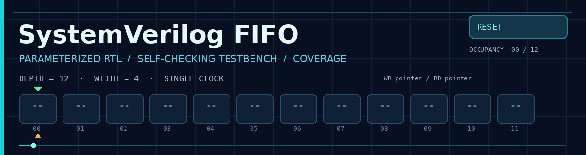
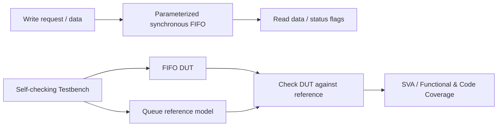
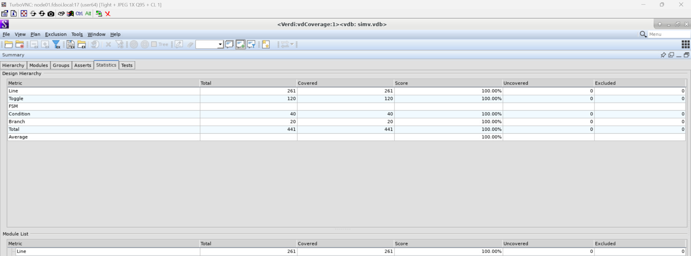
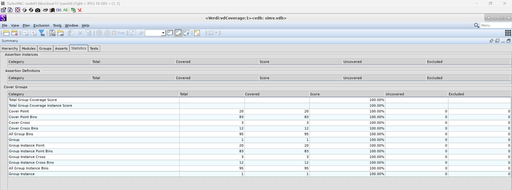
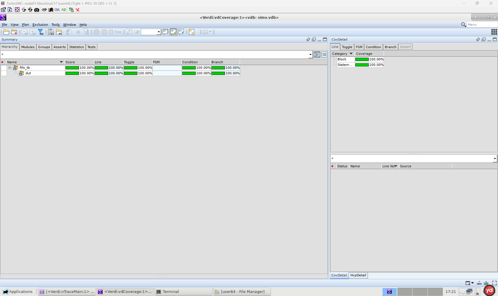
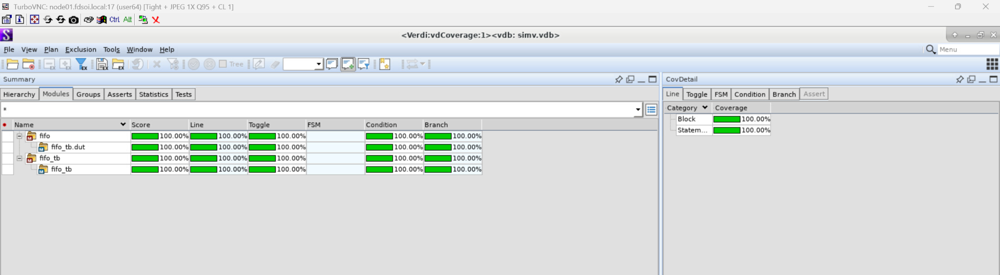
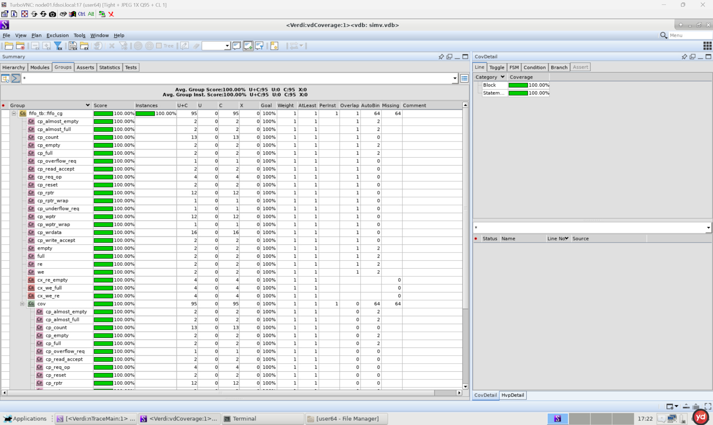
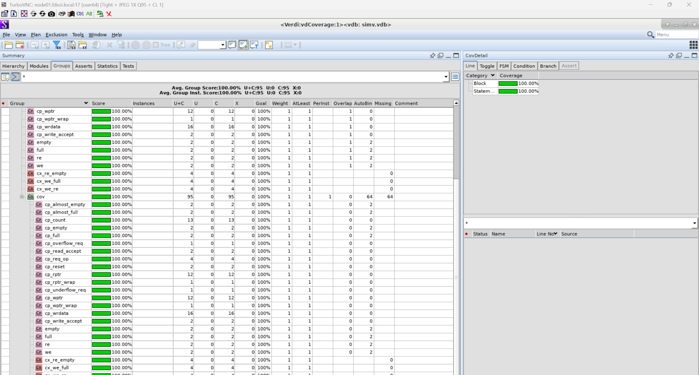

<div align="center">



# SystemVerilog FIFO — RTL Design & Verification

**Parameterized Synchronous FIFO · Queue-Based Scoreboard · SVA · Code & Functional Coverage**


**[English](#english) · [简体中文](#chinese) · [Verification Screenshots / 验证截图](#evidence)**

</div>

---

<a id="english"></a>
## English

### Overview

This project implements and verifies a **parameterizable, single-clock synchronous FIFO** using SystemVerilog. Its RTL supports configurable **data width and depth**, including **non-power-of-two depths**, with circular read/write pointers and full, empty, almost-full and almost-empty status signals. Simultaneous read/write requests, overflow protection and underflow protection are included in the verification scenarios.

A **self-checking testbench** uses a SystemVerilog queue as a reference model to compare the DUT's behavior against expected FIFO ordering and control behavior. Directed and randomized tests, SystemVerilog Assertions (SVA), functional covergroups and cross coverage support debugging and coverage-driven testing.

### Design & Verification Flow



**Main components:** `rtl/fifo.sv`, `tb/fifo_tb.sv`, `sim/run.sh` (paths are based on the project layout provided). The supplied waveform displays a test configuration of **WIDTH=4** and **DEPTH=12**.

### Features

- Parameterized data width/depth; works with non-power-of-two depths.
- Synchronous FIFO with circular pointers and simultaneous read/write handling.
- Full / empty / almost-full / almost-empty indicators.
- Overflow and underflow protection, including boundary and wraparound cases.
- Queue-based scoreboard, directed tests, randomized regression, SVA and cross coverage.

### Verification Scope

Reset and reset-during-operation; writes/reads and data ordering; full/empty conditions; almost-full/almost-empty thresholds; overflows/underflows; simultaneous read/write at normal, empty and full boundaries; pointer wraparound; exhaustive input-data patterns for the configured width; randomized regression; and coverage closure.

### Reported Results

**Code coverage (Verdi — captured run):**

| Metric | Covered / Total | Result |
|:--|--:|--:|
| Line | 261 / 261 | **100%** |
| Toggle | 120 / 120 | **100%** |
| Condition | 40 / 40 | **100%** |
| Branch | 20 / 20 | **100%** |
| Total reported code-coverage items | 441 / 441 | **100%** |

**Functional coverage (Verdi — captured run):**

| Metric | Covered / Total | Result |
|:--|--:|--:|
| Coverpoints | 20 / 20 | **100%** |
| Coverpoint bins | 83 / 83 | **100%** |
| Crosses | 3 / 3 | **100%** |
| Cross bins | 12 / 12 | **100%** |
| Total group bins | 95 / 95 | **100%** |


### Run the Simulation

**Prerequisites:** Linux EDA environment with Synopsys VCS, Verdi and URG, plus Bash; optional `csh`/`tcsh` and Environment Modules for `sim/load_eda.csh`.

```bash
cd sim
chmod +x run.sh
./run.sh
```

If your EDA server uses `csh`/`tcsh` with Environment Modules, load the environment **in that shell** before running the script:

```csh
# Run from the repository root in a csh/tcsh session
source sim/load_eda.csh
cd sim
./run.sh
```

The supplied script is intended to automate EDA environment checks, clean builds, file-list generation, VCS compilation, simulation, URG coverage reporting and optional Verdi waveform/coverage viewing. Actual tool paths, modules and GUI `DISPLAY` settings depend on the server; GUI tools require a working graphical session.

---

<a id="chinese"></a>
## 简体中文

### 项目简介

本项目使用 **SystemVerilog** 设计并验证**参数化单时钟同步 FIFO**，支持可配置数据位宽与存储深度（包括非 2 的整数次幂深度）、环形读写指针、`full` / `empty` / `almost_full` / `almost_empty` 状态标志，并覆盖同时读写、溢出与下溢保护等典型边界情况。

验证环境使用 **SystemVerilog Queue 参考模型**与 DUT 进行自动比对，同时结合定向测试、随机回归、SVA 断言、功能覆盖率及交叉覆盖率，提高问题定位和验证效率。

### 核心功能与验证方法

- **FIFO RTL：** 参数化 `WIDTH`/`DEPTH`、同步读写、满空状态、近满近空阈值、指针回绕、同时读写与保护逻辑。
- **自检环境：** 参考队列模型、DUT 自动比对、定向与随机测试。
- **边界测试：** 空读、满写、空/满时同时读写、指针回绕、运行中复位和数据顺序检查。
- **覆盖率：** 代码覆盖率、Coverpoint、Cross Coverage 以及覆盖率收敛检查。
- **截图配置：** 波形展示的是 `WIDTH=4`、`DEPTH=12`，说明至少该截图所示参数不是 2 的整数次幂深度。

### 已记录的验证结果

代码覆盖率：**Line 261/261、Toggle 120/120、Condition 40/40、Branch 20/20，均为 100%**。FSM 指标未给出适用数值，不能写成 100%。

功能覆盖率：**Coverpoint 20/20、Coverpoint bins 83/83、Crosses 3/3、Cross bins 12/12、全部 Group bins 95/95，均为 100%**。

### 仿真运行

Linux 服务器需具备 **Synopsys VCS、Verdi、URG** 等工具。进入 `sim` 目录并运行：

```bash
cd sim
chmod +x run.sh
./run.sh
```

若服务器使用 Environment Modules，请在 `csh` / `tcsh` 会话内，从仓库根目录执行：

```csh
source sim/load_eda.csh
cd sim
./run.sh
```

`run.sh` 按项目说明用于环境检查、清理、生成 `filelist.f`、编译与仿真、生成覆盖率报告并配合 Verdi 分析。具体 EDA 版本、module 名称以及图形界面的 `DISPLAY` 设置需按服务器配置调整。

---

<a id="evidence"></a>
## Verification Screenshots / 验证截图

These screenshots come from the provided Verdi/Wave evidence. Click an image for its full-resolution version. / 以下截图来自项目实际验证记录，点击图片可查看完整分辨率。

### 1. Code Coverage / 代码覆盖率

<a href="docs/images/code-coverage-statistics.png"></a>

<sub>Verdi statistics: all 441 applicable code-coverage items reported covered. / Verdi 统计：441 项可统计代码覆盖对象均被覆盖。</sub>

### 2. Functional Coverage / 功能覆盖率

<a href="docs/images/functional-coverage-statistics.png"></a>

<sub>Functional bins and cross bins: 95/95. / 功能覆盖率与交叉覆盖率：95/95 bins。</sub>

<details>
<summary><b>More Verdi Views / 展开更多 Verdi 截图（层级、模块与 Covergroups）</b></summary>

**Hierarchy coverage / 层级覆盖率**

<a href="docs/images/coverage-hierarchy.png"></a>

**Module coverage / 模块覆盖率**

<a href="docs/images/coverage-modules.png"></a>

**Covergroup details 1 / 功能覆盖明细 1**

<a href="docs/images/coverage-groups-1.png"></a>

**Covergroup details 2 / 功能覆盖明细 2**

<a href="docs/images/coverage-groups-2.png"></a>

</details>

---

<div align="center">

**SystemVerilog · VCS · Verdi · URG**

<sub>RTL design, self-checking verification and coverage-driven debugging. / RTL 设计、自检验证与覆盖率驱动调试。</sub>

</div>
