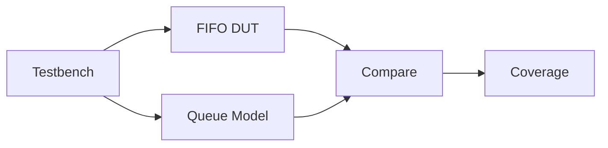

<div align="center">


# SystemVerilog FIFO — RTL Design & Verification

**Parameterized FIFO · Self-Checking Testbench · SVA · Coverage**


**[English](#english) · [简体中文](#chinese) · [Screenshots / 截图](#evidence)**

</div>

---

<a id="english"></a>
## English

### Overview

A **single-clock synchronous FIFO** with parameterized data width and depth (including non-power-of-two depths). Supports circular pointers, `full` / `empty` / `almost_full` / `almost_empty` flags, simultaneous reads/writes, and overflow/underflow protection.

Verification uses a **SystemVerilog queue-based scoreboard**, directed and randomized tests, SVA, and functional/cross coverage. The example waveform configuration is `WIDTH=4`, `DEPTH=12`.

### Verification Flow



### Coverage Results

| Metric | Covered / Total | Result |
|:--|--:|--:|
| Line | 261 / 261 | **100%** |
| Toggle | 120 / 120 | **100%** |
| Condition | 40 / 40 | **100%** |
| Branch | 20 / 20 | **100%** |
| Functional coverpoints | 20 / 20 | **100%** |
| Coverpoint bins | 83 / 83 | **100%** |
| Cross bins | 12 / 12 | **100%** |
| All group bins | 95 / 95 | **100%** |

*Captured Verdi coverage for the measured configuration; FSM coverage is not reported. Coverage is not the same as an all-pass regression.*

### Run

Requires **VCS, Verdi, URG** on a configured Linux EDA server.

```bash
cd sim
chmod +x run.sh
./run.sh
```

Optional `csh`/`tcsh` Environment Modules setup (from the repository root):

```csh
source sim/load_eda.csh
cd sim
./run.sh
```

---

<a id="chinese"></a>
## 简体中文

### 项目简介

基于 **SystemVerilog** 的**参数化单时钟同步 FIFO**：支持可配置位宽与深度（包括非 2 的整数次幂）、环形指针、满/空/近满/近空标志、同时读写及溢出/下溢保护。

验证采用 **Queue 参考模型 + 自动比对**，结合定向测试、随机回归、SVA 断言、功能覆盖率和交叉覆盖率。示例波形配置为 `WIDTH=4`、`DEPTH=12`。

### 验证结果

本次截图记录：**Line 261/261、Toggle 120/120、Condition 40/40、Branch 20/20，全部 100%**；功能覆盖为 **20/20 Coverpoints、83/83 Coverpoint bins、12/12 Cross bins、95/95 Group bins，全部 100%**。FSM 覆盖率未报告。

> 以上为指定仿真配置下的覆盖率统计，不代表全部自动检查都通过。

### 运行

Linux EDA 服务器需配置 **VCS、Verdi、URG**：

```bash
cd sim
chmod +x run.sh
./run.sh
```

如需加载 Environment Modules，请在仓库根目录的 `csh` / `tcsh` 会话中运行：

```csh
source sim/load_eda.csh
cd sim
./run.sh
```

---

<a id="evidence"></a>
## Verification Screenshots / 验证截图

**Code Coverage / 代码覆盖率**

[](docs/images/code-coverage-statistics.png)

**Functional Coverage / 功能覆盖率**

[](docs/images/functional-coverage-statistics.png)

<details>
<summary><b>More screenshots / 更多截图（点击展开）</b></summary>

**Module Coverage / 模块覆盖率**

[](docs/images/coverage-modules.png)

**Hierarchy Coverage / 层级覆盖率**

[](docs/images/coverage-hierarchy.png)

**Covergroups 1 / 功能覆盖明细 1**

[](docs/images/coverage-groups-1.png)

**Covergroups 2 / 功能覆盖明细 2**

[](docs/images/coverage-groups-2.png)

</details>
